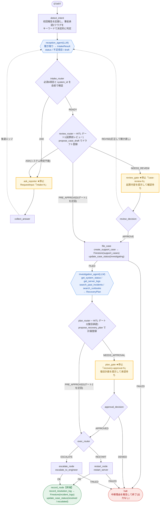
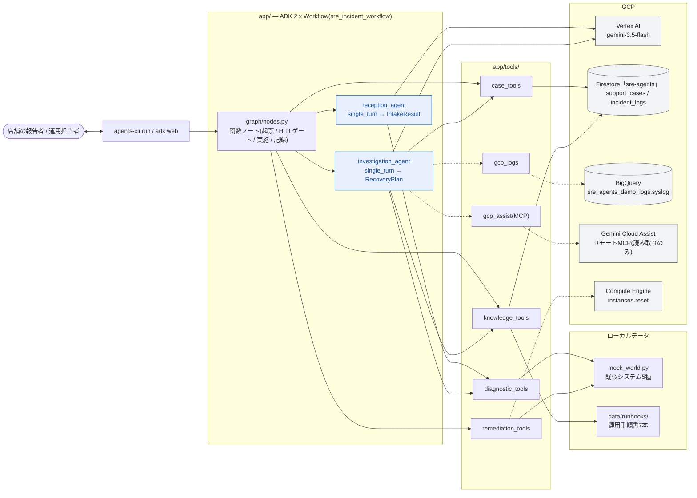

# sre-agents

本部システム(GCP)の障害対応を自動化・半自動化する AI エージェント。
仕様は [`SPEC.md`](./SPEC.md)、開発ガイド・落とし穴は [`CLAUDE.md`](./CLAUDE.md)、
実装経緯は [`working/implementation-log.md`](./working/implementation-log.md) を参照。

Google ADK 2.x / Python / Vertex AI(Gemini)/ Firestore で構築。
`agents-cli` scaffold(v0.5.1)で生成。

---

## 概要

現状は「店舗の障害申請 → 受付が起票 → 運用エンジニアがログ調査・復旧」というチェーンで
時間がかかる。ここを ADK 2.x の **グラフワークフロー**(`app/graph/`)に置き換える。
LLM に任せる判断は 2 つだけで、それ以外の手順はグラフのエッジが決定的に決める:

- **受付エージェント(reception_agent)** — 店舗からの障害報告を日本語で聞き取り、
  必須項目(店舗ID・店舗名 / 対象システム / 症状 / 発生日時 / 影響範囲 / 報告者名)が
  揃ったかを構造化して返す(`IntakeResult`)
- **調査エージェント(investigation_agent)** — サーバー状態・ログ確認、
  過去対応ログ検索 + 運用手順書検索を経て**復旧計画**を構造化して返す(`RecoveryPlan`)

起票・承認ゲート・復旧の実施・対応ログ記録は LLM のツール選択ではなく
グラフの関数ノード(`app/graph/nodes.py`)が行う。

## アーキテクチャ

### ワークフローグラフ(`app/graph/`)



★ = `RequestInput` でワークフローが**実際に停止**する HITL ポイント。
点線は後退エッジ(聞き取りへの差し戻し)。

**HITL の要点(二重ゲートは2箇所)**:
`RequestInput` はワークフローを**実際に停止**させるため、
承認を経ずに `restart_server` / `escalate_to_engineer` へ到達する経路が
**グラフ上に存在しない**。加えて従来どおりツール層の state チェックも残してあり
(`create_support_case` は `propose_case_draft` を、実施系は `propose_recovery_plan` を
通していないとエラー返却)、**グラフ構造 + ツール層の二重防御**になっている。
初回依頼文に「以上の内容で対応をお願いします」「そのまま実施してください」等の
**明示的な続行指示・事前承認**があれば、`detect_intent` のキーワード判定で
該当ゲートを迂回して一気通貫で完走する(ワンショットのデモ・eval はこの経路)。

### システム構成



点線は `SANDBOX_PROJECT_ID` を設定したときだけ有効になる経路
(GCP調査ツールの組み込みと、`restart_server` の GCE 実リセット)。
未設定なら、すべてモックデータの範囲で完結する。

## デモシナリオ

| system_id | 表示名 | ログ異常 | 期待される対応 |
|---|---|---|---|
| `sales-mgmt` | 売上管理システム | DB接続プール枯渇(HikariPool timeout) | 再起動で復旧 |
| `inventory-mgmt` | 在庫管理システム | OutOfMemoryError + Full GC 連発 | 再起動で復旧(`SANDBOX_PROJECT_ID` 設定時は **GCE実リセット**) |
| `order-mgmt` | 発注管理システム | `No space left on device`(DBストレージ枯渇) | 再起動不可 → **エスカレーション** |
| `store-app` | 店舗アプリAPI | 外形監視で HTTP 500 多発(詳細はGCP側) | **Cloud Assist で GCP 層を調査** → エスカレーション |
| `store-web-fleet` | 店舗Webサーバー群 | 監視: store-web-02 のメモリ急上昇+503(実因はOOM) | **BigQuery実ログで調査** → 再起動(**実リセット**) |

各システムのログ 8〜12 行、過去対応ログ 7 件、運用手順書 7 本を用意していて、
LLM は「ログの異常 → 過去事例 → 手順書」の 3 点が同じ結論を指すのを確認しながら判断する。

`store-app` と `store-web-fleet` は**実GCP環境と接続する例**: モックのログは
外形監視・監視サマリーの抜粋のみで、真の原因は GCP 側の実データ
(Cloud Assist の調査 / BigQuery のカーネルログ)でしか特定できない
(後述の「GCP障害シナリオ」参照)。
`inventory-mgmt` は逆パターンで、調査はモックログで完結し、
**復旧(restart_server)だけが実GCPに反映される**
(GCE インスタンス `inventory-mgmt` を実リセット。後述のシナリオ3)。

---

## セットアップ

必要なツール:
- **uv**: [インストール手順](https://docs.astral.sh/uv/getting-started/installation/)
- **Google Cloud SDK**: `gcloud` にログインし ADC を有効化(`gcloud auth application-default login`)

```bash
cp .env.example .env   # GOOGLE_CLOUD_PROJECT を自分のプロジェクトIDに書き換える
make install     # agents-cli~=0.5.0 を tool install + uv sync(dev/eval/lint 全部)
make db-create   # Firestore named DB "sre-agents"(asia-northeast1)を作成 [初回のみ]
make seed        # 過去対応ログ 7 件を投入(冪等)
```

GCP プロジェクトは `.env` の `GOOGLE_CLOUD_PROJECT` で指定する(`make db-create` / `make eval` も
この値を使う。`make PROJECT_ID=...` で上書き可)。エージェント本体は未設定なら ADC から自動解決する。
Firestore の named database 名は `FIRESTORE_DATABASE`(既定: `sre-agents`)。
GCP障害シナリオ(store-app / store-web-fleet)を使う場合のみ `SANDBOX_PROJECT_ID` を設定する(後述)。
参考は [`.env.example`](./.env.example)。

---

## 使い方(make)

| target | 内容 |
|---|---|
| `make install` | 依存一式のインストール(agents-cli ~=0.5.0 + uv sync) |
| `make db-create` | Firestore named DB `sre-agents` を asia-northeast1 に作成(初回のみ) |
| `make seed` | 過去対応ログ 7 件を投入(冪等) |
| `make run` | ワンショット実行(`PROMPT="..."` で上書き可能) |
| `make chat` | サーバー起動+ワンショット。続きは `agents-cli run --session-id <ID> "..."` |
| `make welcome` | ウェルカム画面の確認(受付が「SRE エージェントへようこそ」を返す) |
| `make playground` | `adk web` の対話 UI(ブラウザで動作確認) |
| `make test` | ユニットテスト(LLM 非依存、108 件) |
| `make eval` | `agents-cli eval run`(generate + grade、5 ケース) |
| `make eval-compare BASE=... CAND=...` | 2 つの grade 結果の回帰比較 |
| `make lint` | ruff / format / codespell / ty のチェック |
| `make gcp-incident-create` | GCP障害シナリオ1準備(Cloud Run: API有効化+デプロイ+障害注入)※要 `SANDBOX_PROJECT_ID` |
| `make gcp-incident-status` | store-app の環境変数と直近リクエスト結果を表示 |
| `make gcp-incident-resolve` | GCP障害1を復旧(`FAIL_MODE=none` に戻す) |
| `make gcp-incident-clean` | store-app サービスを削除 |
| `make gce-incident-create` | GCP障害シナリオ2準備(GCE 3台+BigQueryエクスポート+障害注入)※要 `SANDBOX_PROJECT_ID` |
| `make gce-incident-break` | store-web-02 に障害を再注入(resolve 後にもう一度試す場合) |
| `make gce-incident-status` | 3台のWeb応答と store-web-02 の障害プロセス/メモリ状態 |
| `make gce-incident-resolve` | store-web-02 を再起動して復旧(エージェントの restart_server と同等) |
| `make gce-incident-clean` | GCEインスタンス3台を削除 |
| `make inventory-incident-create` | 在庫管理APサーバー役の GCE `inventory-mgmt` を作成(restart_server の実リセット対象)※要 `SANDBOX_PROJECT_ID` |
| `make inventory-incident-status` | inventory-mgmt の稼働状態と直近の操作履歴(reset の実行記録)を表示 |
| `make inventory-incident-resolve` | inventory-mgmt を手動リセット(エージェントの restart_server と同等) |
| `make inventory-incident-clean` | inventory-mgmt インスタンスを削除 |
| `make deploy-setup` | prototype に Agent Runtime 設定を追加(初回のみ) |
| `make deploy` | Agent Runtime へのデプロイ(**要・人間の明示的承認**) |

---

## 動かしてみる(5つの経路)

### 0. ウェルカム画面(挨拶だけの初回入力)

```bash
make welcome
# または
make run PROMPT="こんにちは"
```

→ 受付エージェントが「**SRE エージェントへようこそ**」の案内(担当役割 +
   障害報告に必要な6項目)を返して停止する。ケース起票はしない。
   `adk web`(`make playground`)で最初に "こんにちは" と送っても同じ画面が出る。

### 1. 情報不足の報告 → 追加質問

```bash
make run PROMPT="渋谷店ですが、売上管理システムの調子が悪くて会計に時間がかかっています。なんとかしてもらえますか。"
```

→ 受付が不足項目(店舗ID/発生日時/影響範囲/報告者名 等)を番号付きで質問して終わる。
   ケース起票はしない。

### 2. 完全報告(起票前レビューで停止)

```bash
make run PROMPT="池袋店(店舗ID:2205)の田中です。在庫管理システムで今朝7時半ごろから在庫照会に30秒近くかかり、断続的にエラーも出ています。店内の発注端末2台で発生していて、棚卸作業が止まっています。"
```

→ 必須項目は揃っているが続行指示がないため、**review_gate が起票内容を提示して
   ワークフローが停止(報告者の確認待ち)**。起票・調査はまだ行わない。
   続きは同セッションで確認を返す:
   `agents-cli run "はい、その内容でお願いします。" --session-id <表示されたID>`
   → 起票 → 調査 → plan_gate で計画提示 → 承認待ち、と多段HITLで進む。
   (`RequestInput` による停止からの再開手順は `agents-cli run` では未検証。
   ワンショットのデモ 3・4 は事前承認でゲートを迂回するため影響を受けない。)

### 3. 完全報告 + 続行指示(承認待ち経路)

```bash
make run PROMPT="渋谷店(店舗ID:1102)の佐藤です。売上管理システムで今朝9時ごろからレジの会計時に「売上データの送信がタイムアウトしました」というエラーが出ます。店内のレジ2台すべてで発生していて、他の業務は正常です。報告内容は以上の通りで間違いありませんので、このまま起票して原因の調査と対応方針の提案を進めてください。復旧作業の実施は私の承認を得てから進めてください。"
```

→ `detect_intent` が**続行指示ありと判断して起票前レビューを迂回**し、起票 → 調査 →
   **plan_gate で計画提示 → ワークフローが停止して承認待ち**。`restart_server` は呼ばれない。

### 4. 完全報告 + 事前承認(フル自走)

```bash
make run PROMPT="渋谷店(店舗ID:1102)の佐藤です。売上管理システムで今朝9時ごろからレジの会計時に「売上データの送信がタイムアウトしました」というエラーが出ます。店内のレジ2台すべてで発生していて、他の業務は正常です。原因を特定し対応計画を提示した上で、そのまま復旧作業まで実施してください。追加の承認は不要です(事前承認済み)。"
```

→ 内容提示 → 起票 → 調査 → propose → **承認済みとみなして** restart_server → 稼働確認 →
   record_resolution_log → status を resolved に更新まで自走(所要 30〜40 秒)。

対話 UI から触りたい場合は `make playground`(ブラウザで開く)。

---

## GCP障害シナリオ(実GCP環境との接続)

モックに加えて、**実際のGCP障害**を調査・復旧させる例が2つある。
シナリオの ground truth・証跡の場所は [`working/demo-scenarios.md`](./working/demo-scenarios.md) 参照。

### シナリオ1: `store-app`(Cloud Run / アプリ層)

調査エージェントに [Gemini Cloud Assist のリモート MCP サーバー](https://docs.cloud.google.com/cloud-assist/use-gemini-cloud-assist-mcp)
(`https://geminicloudassist.googleapis.com/mcp`)がツールセットとして組み込まれ、
`investigate_issue` / `ask_cloud_assist` で GCP 側の実ログ・構成を調査する。

```
investigation_agent
   ├─ get_system_status("store-app")     → 外形監視: HTTP 500 多発(platform: Cloud Run)
   ├─ investigate_issue(project="projects/$SANDBOX_PROJECT_ID", ...)   ← Cloud Assist MCP
   │      → Cloud Run 側の ERROR ログ・リビジョン(環境変数変更)を特定
   ├─ search_past_incidents / search_runbooks → 「エスカレーション」の根拠
   └─ propose_recovery_plan(HITL) → 承認 → escalate_to_engineer
```

### シナリオ2: `store-web-fleet`(GCE / インフラ層・メモリリーク→OOM)

実体は Compute Engine 3台(store-web-01/02/03)。store-web-02 に障害を注入すると
メモリリークが進行し、約8〜10分後にカーネルの OOM Killer がプロセスを強制終了。
その実ログが Cloud Logging → BigQuery(`sre_agents_demo_logs.syslog`)へ
エクスポートされ、調査エージェントは `query_incident_bigquery_logs` で検索する。

```
investigation_agent
   ├─ get_system_status("store-web-fleet") → 監視: store-web-02 メモリ95% + 503
   ├─ query_incident_bigquery_logs("Out of memory")          ← BigQuery 実ログ
   │      → カーネルの「Out of memory: Killed process (python3)」を発見
   ├─ search_past_incidents / search_runbooks → 「再起動で復旧」の根拠
   └─ propose_recovery_plan(HITL) → 承認 → restart_server
                                        └─ ★ Compute Engine API で store-web-02 を実リセット
```

**restart_server は実際のインスタンスリセットを行う**
(`app/tools/remediation_tools.py` の差し替えポイントの実装例)。
エージェント承認後の復旧が実VMに反映されるため、`make gce-incident-resolve` を
人手で実行する必要はない(HITL 承認は従来どおり必須)。

### シナリオ3: `inventory-mgmt`(GCE / 調査はモック・復旧のみ実GCP)

在庫管理システムの障害(Java heap OOM)は従来どおりモックログ・過去事例・手順書で
調査が完結するが、restart_server は GCE インスタンス `inventory-mgmt` を
**実際にリセット**する(store-web-fleet と同じ差し替え実装。HITL 承認は必須)。
「調査は社内データで完結し、復旧操作だけが実環境に反映される」構成の例で、
障害注入や BigQuery エクスポートは使わない。

```
investigation_agent
   ├─ get_system_status / get_server_logs("inventory-mgmt")
   │      → OutOfMemoryError: Java heap space + Full GC 連発(モックログ)
   ├─ search_past_incidents(INC-2025-0002)/ search_runbooks(inventory-mgmt.md)
   │      → 「APサーバー(インスタンス inventory-mgmt)の再起動で復旧」の根拠
   └─ propose_recovery_plan(HITL) → 承認 → restart_server
                                        └─ ★ Compute Engine API で inventory-mgmt を実リセット
```

### 前提と設定

- **調査対象のプロジェクトIDは環境変数 `SANDBOX_PROJECT_ID` から取得する**
  (エージェント本体の `GOOGLE_CLOUD_PROJECT` とは別。未設定なら GCP調査ツール
  (Cloud Assist / BigQueryログ検索)は組み込まれず、モックデータの範囲だけで動く。
  eval / CI は未設定で実行)。
- Cloud Assist MCP は**プレビュー機能**。呼び出しには対象プロジェクトで
  `geminicloudassist.googleapis.com` の有効化と、呼び出しアカウントへの
  **`roles/mcp.toolUser` + `roles/geminicloudassist.user`** が必要
  (**`roles/owner` だけでは不足**)。加えて `gcloud run deploy --source` を
  新規プロジェクトで初回実行する際、デフォルトのコンピュート SA に
  `roles/cloudbuild.builds.builder` が必要。この3つの付与と API 有効化は
  `scripts/gcp_incident.sh setup` が一括で行う(**初回のみ・要オーナー権限**)。

### 使い方

```bash
export SANDBOX_PROJECT_ID=your-sandbox-project-id   # デモ用に用意しているサンドボックス

# --- シナリオ1: Cloud Run(store-app) ---
make gcp-incident-create    # API有効化+ロール付与 → store-app デプロイ → 障害注入
make run PROMPT="池袋店(店舗ID:2205)の田中です。店舗アプリが今朝10時ごろから全部エラーになります。店舗のハンディ端末すべてで発生していて、モバイルオーダーも止まっています。報告内容は以上の通りで間違いありませんので、このまま起票して調査を進めてください。復旧作業は私の承認を得てから進めてください。"
make gcp-incident-resolve   # 承認・エスカレーション後の「インフラ運用チーム役」: 復旧
make gcp-incident-clean     # デモ環境の削除

# --- シナリオ2: GCE(store-web-fleet) ---
make gce-incident-create    # GCE 3台 + BigQueryエクスポート作成 → 障害注入
# (注入後8〜10分待つと OOM Killer が発動し、BigQuery に実証跡が入る)
make run PROMPT="池袋店(店舗ID:2205)の田中です。店舗向けの案内ページ(店舗Webサーバー)が今日の夕方から表示が非常に遅く、時々エラー画面になります。他の店舗でも同じ症状と聞いています。報告内容は以上の通りで間違いありませんので、このまま起票して調査を進めてください。復旧作業は私の承認を得てから進めてください。"
# → 承認すると restart_server が store-web-02 を実リセットして復旧する
make gce-incident-break     # もう一度試す場合の障害再注入
make gce-incident-clean     # GCEインスタンス3台の削除

# --- シナリオ3: GCE(inventory-mgmt / 復旧のみ実GCP) ---
make inventory-incident-create   # APサーバー役の GCE インスタンスを作成(障害注入は無し)
make run PROMPT="渋谷店(店舗ID:1102)の佐藤です。在庫管理システムの在庫照会が今朝から30秒近くかかり、時々エラーになります。店内の端末2台で発生していて、棚卸業務に支障が出ています。報告内容は以上の通りで間違いありませんので、このまま起票して調査を進めてください。復旧作業は私の承認を得てから進めてください。"
# → 承認すると restart_server が inventory-mgmt を実リセットする
#   (実際に再起動されたことは make inventory-incident-status の操作履歴 operationType=reset で確認できる)
make inventory-incident-clean    # インスタンスの削除
```

障害の実体は Cloud Run サービス `store-app` の環境変数 `FAIL_MODE=db_timeout`
(全リクエストが DB接続タイムアウト風の ERROR ログを出して 500 になる。
`/healthz` は 200 のまま)。実装は `scripts/gcp_incident_app/`、
操作は `scripts/gcp_incident.sh`(deploy は認証必須のまま。公開したい場合のみ
`scripts/gcp_incident.sh expose` を明示実行)。

Cloud Assist への調査は読み取りのみに限定している(instruction で復旧操作の依頼を
禁止し、`tool_filter` で mutative な `invoke_operation` 等を外している)。
復旧は従来どおり `propose_recovery_plan` → 承認 → 実施の HITL フロー。

---

## GCEインフラ障害シナリオ(メモリリーク / Ops Agent → BigQuery)

`store-app`(Cloud Run / アプリ層)に加えて、**インフラ層(VM)の障害**を再現する
シナリオ。同じサンドボックスプロジェクト(`SANDBOX_PROJECT_ID`)に e2-micro を
3台(`store-web-01` / `store-web-02` / `store-web-03`、いずれもnginxで外形上は
Webサーバーとして応答)起動し、Ops Agent でログ・メトリクスを収集、
Cloud Logging から BigQuery へエクスポートする。

- `store-web-01` / `store-web-03`: 常に健全
- `store-web-02`: `break` 実行時にメモリリークプロセス(`memleak.py`。5MB/5秒で
  確保し続け、e2-micro(メモリ1GB)ではおよそ8〜10分でカーネルの OOM Killer に
  強制終了される=**実際のOOM障害**)と、擬似障害ログ生成(`logger -t store-app` で
  応答遅延・DB接続プール枯渇・ヘルスチェック失敗などのWARN/ERR/CRITをsyslogへ)を起動する

`resource.type="gce_instance"` のログ(syslog。カーネルの実OOMログと擬似障害ログの
両方を含む)は、エクスポートsink `sre-agents-demo-sink` 経由で BigQuery データセット
`sre_agents_demo_logs`(テーブル: `syslog` / `ops_agent_fluent_bit` / `ops_agent_health`)
に転送される。

### 前提と設定

- `store-app` シナリオと**同じ `SANDBOX_PROJECT_ID`** を使う(未設定ならエラー)。
- `setup` は compute API有効化・ファイアウォール(HTTP)作成・default Compute SA への
  `roles/logging.logWriter` + `roles/monitoring.metricWriter` 付与・BigQueryデータセット
  作成・エクスポートsink作成(と、そのwriter identityへのデータセットアクセス権付与)を
  一括で行う(**初回のみ。IAMロール付与を含むため内容を確認のうえ実行すること**)。

### 使い方

```bash
export SANDBOX_PROJECT_ID=your-sandbox-project-id   # store-app シナリオと共通

make gce-incident-create    # setup → 3台デプロイ → store-web-02で障害注入
make gce-incident-status    # 3台のWeb応答 + store-web-02の障害プロセス/メモリ状態
make gce-incident-resolve   # store-web-02を再起動して復旧(リーク解消)
make gce-incident-break     # resolve後にもう一度障害を試す場合
make gce-incident-clean     # 3台のインスタンスを削除(ファイアウォール/BigQuery/sinkは残す)
```

**注記**: 現時点ではインフラ(VM/ログ/BigQuery)の用意のみで、`investigation_agent`
側に「このVM群/BigQueryのログを調べる」専用ツールはまだ配線していない。
`SANDBOX_PROJECT_ID` を共有しているため Gemini Cloud Assist が Compute Engine 層の
情報を拾える可能性はあるが未検証。エージェントから調査させるには、
BigQuery/Cloud Loggingを読む専用ツールの追加が別途必要(フォローアップ)。

---

## プロジェクト構成

```
sre-agents/
├── SPEC.md                          # スペック(日本語、権威)
├── CLAUDE.md                        # AI開発ガイド + 落とし穴メモ
├── README.md                        # このファイル
├── Makefile                         # よく使うコマンド一式
├── pyproject.toml / uv.lock         # 依存関係(google-adk 2.x, google-cloud-firestore)
├── agents-cli-manifest.yaml         # agents-cli 管理(手動編集禁止)
├── .env.example                     # 環境変数のテンプレート
├── app/
│   ├── agent.py                     # App(name="app") + root_agent
│   ├── config.py                    # MODEL_ID, FIRESTORE_DATABASE, RUNBOOK_DIR, SANDBOX_PROJECT_ID
│   ├── firestore_client.py          # named DB "sre-agents" の遅延シングルトン
│   ├── mock_world.py                # 疑似システム5種の決定論的レジストリ
│   ├── graph/                       # ★ ADK 2.x グラフワークフロー
│   │   ├── __init__.py              # build_workflow():ノードとエッジの組み立て
│   │   ├── nodes.py                 # 関数ノード(起票 / 承認ゲート / 実施 / 記録)
│   │   ├── preapproval.py           # 事前承認のキーワード判定(LLM を介在させない)
│   │   └── schemas.py               # IntakeResult / CaseFiled / RecoveryPlan 等
│   ├── sub_agents/
│   │   ├── __init__.py              # build_model / build_generate_content_config
│   │   ├── reception.py             # 受付エージェント(聞き取り結果を構造化して返す)
│   │   └── investigation.py         # 調査エージェント(復旧計画を構造化して返す)
│   └── tools/
│       ├── case_tools.py            # propose_case_draft(起票前レビュー)+ create/get/update support_case
│       ├── diagnostic_tools.py      # list_managed_systems / get_system_status / get_server_logs
│       ├── gcp_assist.py            # ★ Gemini Cloud Assist リモートMCP ツールセット
│       ├── gcp_logs.py              # ★ BigQuery ログエクスポート検索(GCEシナリオ)
│       ├── knowledge_tools.py       # search_past_incidents / search_runbooks / record_resolution_log
│       └── remediation_tools.py     # ★ propose_recovery_plan / restart_server(store-web-fleet / inventory-mgmt は実リセット)/ escalate_to_engineer
├── data/runbooks/                   # 運用手順書 7 本(日本語)
├── scripts/
│   ├── seed_firestore.py            # 過去対応ログ 7 件のシード(冪等)
│   ├── gcp_incident.sh              # GCP障害シナリオ(store-app/Cloud Run)の setup/deploy/break/resolve/clean
│   ├── gcp_incident_app/            # store-app の実体(Flask、FAIL_MODE で障害切替)
│   ├── gce_incident.sh              # GCEインフラ障害シナリオ(store-web-01/02/03)の setup/deploy/break/status/resolve/clean
│   ├── gce_incident_startup/        # store-web-* の起動スクリプト(base.sh / incident.sh)
│   └── inventory_incident.sh        # 在庫管理APサーバー役 GCE(inventory-mgmt)の create/status/resolve/clean
├── tests/
│   ├── unit/                        # ユニットテスト 108 件(LLM 非依存)
│   │   ├── test_mock_world.py       # レジストリ整合性
│   │   ├── test_search_logic.py     # キーワード検索の純関数
│   │   ├── test_agent_wiring.py     # グラフの配線(ノード / エッジ / モデル)
│   │   ├── test_graph_flow.py       # 事前承認判定・各ルーターの分岐・停止イベント
│   │   ├── test_eval_metrics.py     # eval の決定論メトリクスの検出力
│   │   ├── test_gcp_assist.py       # Cloud Assist MCP 連携の配線(ネットワーク非依存)
│   │   ├── test_gce_scenario.py     # GCEシナリオ(実リセット経路 / BigQueryツール)
│   │   ├── test_hitl_gating.py      # HITL ゲート(propose なしなら実施拒否)
│   │   └── test_intake_review.py    # 起票前レビューゲート(propose_case_draft なしなら起票拒否)
│   ├── integration/                 # (scaffold の雛形。今は未使用)
│   └── eval/
│       ├── eval_config.yaml         # カスタムメトリクス 3 本(LLM判定 2 + 決定論 1)
│       ├── make_negative_trace.py   # 違反を注入したネガティブコントロールの生成
│       └── datasets/basic-dataset.json # 5 ケース
└── working/
    ├── implementation-log.md        # 実装作業ログ
    └── demo-scenarios.md            # サンドボックスの障害デモシナリオ一覧(ground truth・証跡・操作方法)
```

---

## 評価(eval)

5 ケース、全て満点(2026-07-16 時点):

| ケース | task_success | flow_compliance | trajectory_checks |
|---|---|---|---|
| `intake_interview_incomplete`(情報不足→追加質問) | 5.0 | 5.0 | 1.0 |
| `intake_review_awaits_confirmation`(完全報告 → 起票前レビューで停止) | 5.0 | 5.0 | 1.0 |
| `propose_awaits_approval`(完全報告+続行指示 → propose で停止) | 5.0 | 5.0 | 1.0 |
| `pre_approved_resolution`(事前承認 + sales-mgmt → 再起動で復旧) | 5.0 | 5.0 | 1.0 |
| `pre_approved_escalation`(事前承認 + order-mgmt → エスカレ) | 5.0 | 5.0 | 1.0 |

メトリクス:
- `sre_task_success`(LLM 判定): その時点で達成すべきゴールを達成しているか
- `sre_flow_compliance`(LLM 判定): 受付・調査・HITL・完了の各段階の手順遵守
- `sre_trajectory_checks`(決定論): ツール呼び出し順序(propose 前に action しない等)

`make eval` は generate + grade を一気に走らせる。artifact は `artifacts/traces/` と
`artifacts/grade_results/` に保存(`.gitignore` 済み)。
仕様変更後は古い trace を掃除してから再実行(全 trace が grade 対象になるため)。

---

## デプロイ(未実施 — 明示的な承認が必要)

```bash
make deploy-setup    # scaffold enhance で agent_runtime 設定を追加(初回のみ)
make deploy          # agents-cli deploy(Agent Runtime へ、所要5〜10分)
```

- Agent Runtime の Python は 3.12 固定
- `data/runbooks/` がバンドルに含まれることを事前確認
- **`make deploy` は人間の明示的な承認のもとでのみ実行すること**

## 実装差し替えのポイント

復旧・エスカレーションは基本モックで、
[`app/tools/remediation_tools.py`](./app/tools/remediation_tools.py) の
`restart_server` / `escalate_to_engineer` が実環境への差し替えポイント:

| ツール | 差し替え先の例 | 実装済みの実例 |
|---|---|---|
| `restart_server` | Compute Engine API の instances.reset / MIG の rolling restart | **`store-web-fleet` / `inventory-mgmt` は実装済み**(`SANDBOX_PROJECT_ID` 設定時、store-web-02 / inventory-mgmt を実リセット) |
| `escalate_to_engineer` | PagerDuty / Opsgenie / Slack webhook / Cloud Tasks | (モックのまま) |

シグネチャと返却契約(`{"status": ..., ...}` の dict)を維持すれば、
エージェントの instruction や eval を書き換えずに実運用へ移行できる。

## 観測性

`agents-cli` が生成した OpenTelemetry 計装で Cloud Trace / Cloud Logging に自動連携。
BigQuery Agent Analytics を有効化する場合は
`agents-cli scaffold enhance --bq-analytics`。
